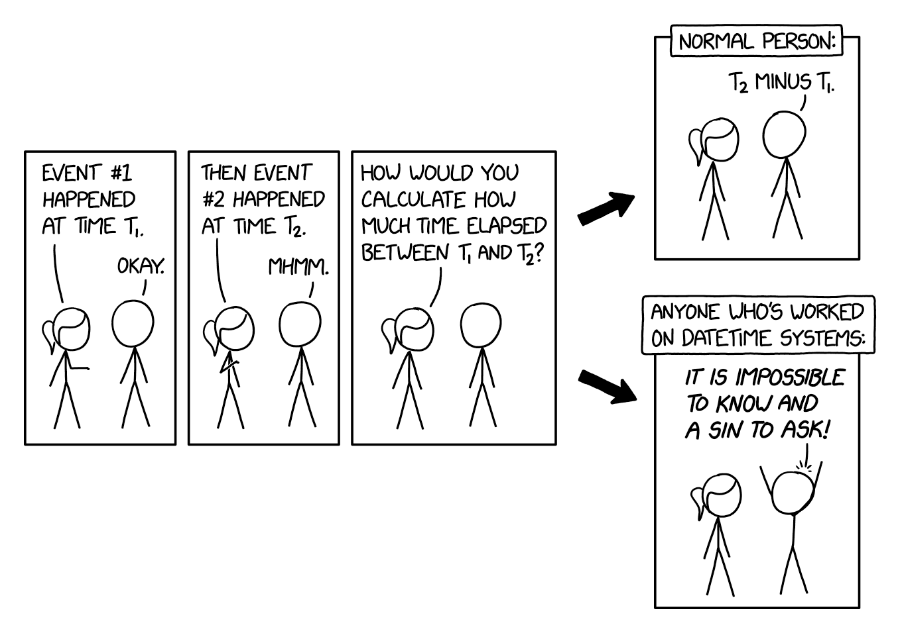

# CODA

Contextual Operations Data Activation

https://coda.fit.nasa.gov/

Consolidating the context of missions, training, and testing into an easy to use platform to relive and revisit each moment. For more info, see https://wiki.jsc.nasa.gov/exploration/index.php/CODA.

Other CODA clock tools

- **The clocksync app**: https://coda.fit.nasa.gov/clocksync/index.html
- **The clockcalc app**: https://coda.fit.nasa.gov/clockcalc/clockcalc.html

## Environments

CODA is deployed using GitLab CI/CD and FIT-provisioned VMs.

| **Branch** | **Environment** | **URL**                         |
| ---------- | --------------- | ------------------------------- |
| `prod`     | production      | https://coda.fit.nasa.gov       |
| `int`      | integration     | https://coda-int.fit.nasa.gov   |
| any        | development     | Any EMSS dev server (see below) |

EMSS dev servers all have element names, and are:

- https://carbon-emss-dev.fit.nasa.gov
- https://gold-emss-dev.fit.nasa.gov
- https://iron-emss-dev.fit.nasa.gov
- https://neon-emss-dev.fit.nasa.gov
- https://oxygen-emss-dev.fit.nasa.gov

## Development

### Software Dependencies

- [NodeJS](https://nodejs.dev/) >= 22.19.0 (see the [Dockerfile](./docker/apiv1/Dockerfile) for the version we're using).
- [Docker Desktop](https://www.docker.com/products/docker-desktop/) (optional)

### First Time Setup

1. Install JavaScript dependencies: `npm i`
2. Get the secret values from another CODA developer and paste them into a new file called `env.secret.ts`.
3. Create a `./.env` file by running `npm run make-dotenv` in the terminal.
4. Get the required NOCA (NASA Operational Certification Authority) Cert. This is required so CODA will authenticate other NASA website's certs.
   1. Go to https://cset.nasa.gov/ascs/application/trust-anchor-management-ntam-for-linux/
   2. In section "Installation for Linux Desktop Use Cases (RHEL only)" (Linux variety is fine for all OSes) go to the "Manual Installation" section
   3. Download zip file
   4. Extract zip and put the `.pem` file into the CODA root directory named `.env.local.cert.pem`

5. Map `coda-local.fit.nasa.gov` to `127.0.0.1` so the browser uses the hostname required for direct IO and Talkybot connections. Follow [Windows with admin rights](#windows-with-admin-rights) to edit the hosts file, or use the [Chrome hostname override](#windows-without-admin-rights) without admin rights.
6. The first `npm run dev` creates a local HTTPS certificate and asks Windows to trust it. Expect a security prompt; see [Local HTTPS certificate](#local-https-certificate) for exactly what happens.
7. (Optional unless you're making a lot of map requests) Get a Mapbox API key https://account.mapbox.com/. Set it to the `VITE_PUBLIC_MAPBOX_KEY` value in the `.env` file.

#### Windows with admin rights

1. Search for **Notepad** in the Start menu, right-click it, and select **Run as administrator**. Approve the elevation prompt.
2. In Notepad, select **File > Open**, browse to `C:\Windows\System32\drivers\etc`, and change the file filter from **Text Documents** to **All Files**. Open `hosts`.
3. Add this line, or update an existing entry for the same hostname:

   ```text
   127.0.0.1 coda-local.fit.nasa.gov
   ```

4. Save the existing `hosts` file without adding a `.txt` extension. Keep the port number out of this file.
5. Start CODA using the instructions below and open `https://coda-local.fit.nasa.gov:3000` in your normal browser. For the Docker preview, use `https://coda-local.fit.nasa.gov`.

If the browser cached a failed lookup, restart it. If needed, run `ipconfig /flushdns` in an administrator terminal to clear the Windows DNS cache.

Alternatively, use **PowerToys > Hosts File Editor** with **Open as administrator** enabled. Add an active entry with address `127.0.0.1` and host `coda-local.fit.nasa.gov`. PowerToys also requires elevation to save changes.

The hosts entry applies to Windows applications using the system resolver, so no special Chrome launch arguments are needed. Containers and WSL may need their own hostname configuration.

If you also run other EMSS apps locally, add their hostnames too (for example `talkybot-local.fit.nasa.gov` and `aegis-local.fit.nasa.gov`, each as `127.0.0.1 <hostname>`), then run `ipconfig /flushdns`.

**Recommended Chrome shortcut with a hosts file.** To keep many local test windows and have them restore on launch, use a dedicated profile and no URL. The profile's **On startup** setting must be **Continue where you left off** (`chrome://settings/onStartup`):

```text
"C:\Program Files\Google\Chrome\Application\chrome.exe" --user-data-dir="%LOCALAPPDATA%\Chrome-EMSS-Dev"
```

This avoids the "unsupported command-line flag" warning described [below](#windows-without-admin-rights), because no `--host-resolver-rules` flag is needed.

#### Windows without admin rights

Launch Chrome from PowerShell with a hostname override and a separate development profile:

```powershell
& "$env:ProgramFiles\Google\Chrome\Application\chrome.exe" `
  "--user-data-dir=$env:LOCALAPPDATA\Chrome-Coda-Dev" `
  "--host-resolver-rules=MAP coda-local.fit.nasa.gov 127.0.0.1" `
  "https://coda-local.fit.nasa.gov:3000"
```

Adjust the executable path if Chrome is installed elsewhere. The separate profile allows normal Chrome to stay open alongside development Chrome; its cookies and sign-ins are separate, so sign in through the development window.

For a reusable shortcut, right-click the Windows desktop, select **New > Shortcut**, and paste the following as the location (adjusting Chrome's path if needed):

```text
"C:\Program Files\Google\Chrome\Application\chrome.exe" --user-data-dir="%LOCALAPPDATA%\Chrome-Coda-Dev" --host-resolver-rules="MAP coda-local.fit.nasa.gov 127.0.0.1" "https://coda-local.fit.nasa.gov:3000"
```

Name it **CODA Dev** and use it whenever opening local CODA. The override must be supplied each time this development Chrome instance starts; the regular Chrome shortcut does not supply it. Close all windows using the development profile before relaunching if you change the arguments.

**Expected Chrome warning.** Chrome shows an infobar reading "You are using an unsupported command-line flag: --host-resolver-rules=...  Stability and security will suffer." This is expected. Chromium hard-codes `--host-resolver-rules` in its list of "bad flags" because it can redirect traffic (see [`bad_flags_prompt.cc`](https://chromium.googlesource.com/chromium/src/+/main/chrome/browser/ui/startup/bad_flags_prompt.cc)). It is only a warning, and the mapping still works. No flag or setting suppresses it. You can dismiss it, or add a hosts-file entry as described in [Windows with admin rights](#windows-with-admin-rights) and drop the flag.

**Several local apps.** `--host-resolver-rules` takes a comma-separated list, so one shortcut can cover multiple apps (no URL is needed, which lets Chrome restore your previous windows if **On startup** is set to **Continue where you left off**):

```text
"C:\Program Files\Google\Chrome\Application\chrome.exe" --user-data-dir="%LOCALAPPDATA%\Chrome-EMSS-Dev" --host-resolver-rules="MAP coda-local.fit.nasa.gov 127.0.0.1,MAP talkybot-local.fit.nasa.gov 127.0.0.1,MAP aegis-local.fit.nasa.gov 127.0.0.1"
```

This maps only the hostname within that Chrome instance. It keeps the hostname in the URL for shared auth cookies and leaves port `3000` unchanged. Node, Docker, and other applications do not inherit the mapping. For the Docker preview, open `https://coda-local.fit.nasa.gov` in the same development Chrome window instead.

The override handles name resolution only; the URL and the [local certificate](#local-https-certificate) both use `coda-local.fit.nasa.gov`, so HTTPS works. Keep HTTPS and that hostname for shared authentication.

References: [Chromium hostname overrides](https://github.com/chromium/chromium/blob/main/net/dns/README.md), [Chrome profile directories](https://chromium.googlesource.com/chromium/src/+/HEAD/docs/user_data_dir.md), and [PowerToys Hosts File Editor permissions](https://learn.microsoft.com/en-us/windows/powertoys/hosts-file-editor).

#### Local HTTPS certificate

CODA needs HTTPS on `coda-local.fit.nasa.gov` so the shared `.fit.nasa.gov` auth cookie works. On the first `npm run dev`, [vite-plugin-mkcert](https://github.com/liuweiGL/vite-plugin-mkcert) does the following automatically:

1. **Downloads [mkcert](https://github.com/FiloSottile/mkcert)** (a small open-source tool) from its GitHub releases into `.local/mkcert/`.
2. **Creates a private certificate authority (CA)** unique to your machine: `rootCA.pem` and `rootCA-key.pem` in `.local/mkcert/`.
3. **Installs the CA's public certificate into your Windows user trust store** (Trusted Root Certification Authorities, current user). **This is the security prompt you see.** Windows shows "You are about to install a certificate from a certification authority (CA) claiming to represent: mkcert ..."; choose **Yes**. Administrator rights are normally not needed. On a managed device that blocks user-installed CAs, ask your administrator.
4. **Issues a server certificate** for `coda-local.fit.nasa.gov` (plus `localhost` and your local IPs), signed by that CA, to `.local/certs/nginx.crt` and `.local/private/nginx.key`. Vite and the Docker preview both use these files.

After that, Chrome and Edge trust `https://coda-local.fit.nasa.gov:3000`; restart the browser if it still shows a warning. Later runs reuse everything; the server certificate is only reissued if the hostname list changes.

Good to know:

- Everything lives in the git-ignored `.local/` directory. Nothing is sent anywhere, and the CA is trusted only on your machine and user account.
- Keep `.local/mkcert/rootCA-key.pem` private. Anyone with it could mint certificates your machine trusts.
- Node, Docker containers, and WSL do not use the Windows trust store, which is why CODA's server-side requests use `.env.local.cert.pem` instead.
- Generate the certificate without starting the dev server (for example before `npm run docker:preview`) with `npm run dev:cert`.
- To remove the trust, run this in PowerShell from the CODA root, then delete `.local/mkcert/`:

  ```powershell
  $env:CAROOT = "$PWD\.local\mkcert"; .\.local\mkcert\mkcert.exe -uninstall
  ```

#### Optional: Attach the VS Code browser debugger

To debug client-side code from VS Code, add `--remote-debugging-port=9222` to the Chrome command or shortcut above, before the URL. For example, this combines debugging with the no-admin hostname override:

```powershell
& "$env:ProgramFiles\Google\Chrome\Application\chrome.exe" `
  "--user-data-dir=$env:LOCALAPPDATA\Chrome-Coda-Dev" `
  "--remote-debugging-port=9222" `
  "--host-resolver-rules=MAP coda-local.fit.nasa.gov 127.0.0.1" `
  "https://coda-local.fit.nasa.gov:3000"
```

With a hosts-file entry, omit `--host-resolver-rules` but keep the separate profile and debugging port. Chrome 136 and later require a non-default `--user-data-dir` for remote debugging; see [Chrome's remote debugging requirements](https://developer.chrome.com/blog/remote-debugging-port). Close all windows using the development profile before relaunching with the new flag. Only one Chrome instance can listen on port `9222` at a time.

Start CODA, open its HTTPS URL in that Chrome window, then select **Chrome Attach** in VS Code's **Run and Debug** panel and press **F5**. The configuration in [`.vscode/launch.json`](.vscode/launch.json) attaches on port `9222` and matches `https://coda-local.fit.nasa.gov:3000/*`. Set breakpoints in client-side source files. Use **Node Attach** to debug the API instead. Browser DevTools (F12) works without the remote debugging flag.

### Option 1: Local Dev (non-Docker)

To start CODA locally for development, run the following

```sh
npm run docker:services
npm run dev
```

Then go to https://coda-local.fit.nasa.gov:3000. Vite reuses the [local HTTPS certificate](#local-https-certificate) from step 6.

#### Shared authentication in Vite

Local HTTPS and auth configuration lives in `src/dev/viteLocalDevelopment.ts`,
with the auth gateway in `src/dev/viteSharedAuth.ts`. The main Vite config adds
them only for the dev server; builds, preview, and tests use the base config.
Vite's built-in proxy handles forwarding.

Local development uses the same production shared-auth service as deployed CODA.
With `MOCK_USER="false"` (the default), Vite validates the browser's session cookie
with `https://${AUTH_HOST}/oauth2/auth` and forwards the returned JWT to the local
API as `X-Access-Token`. The local API listens only on `127.0.0.1` during development.
Your real identity and roles are used for admin pages and restricted media.

Vite proxies `/oauth2/*` to the shared auth service and supplies `/login` for the
existing popup helper. Open `/logout` to clear the shared session and return to
`/login` for a new JWT sign-in. Unauthenticated page and protected API requests
redirect to sign-in, preserving the local port and query parameters. The auth
service must allow return URLs on port 3000; that is separate from Talkybot's CORS
allowlist.

Keep `AUTH_HOST="emss-auth.fit.nasa.gov"` to share a session with production
Talkybot. To test against integration auth, set
`AUTH_HOST="emss-auth-int.fit.nasa.gov"` and restart Vite and the API. Vite trusts
the NASA CA bundle in `.env.local.cert.pem` for its server-side auth requests.

After the first certificate setup, for offline development set `MOCK_USER="true"` in `.env` and restart
`npm run dev`. This disables Vite's shared-auth gateway and uses the existing mock
CODA user. HTTPS stays enabled using the cached certificate. Mock mode does not
authenticate direct Talkybot requests.

#### Talkybot communications in local development

The comm panel connects directly to production Talkybot using the same browser session established by CODA's shared-auth login. In offline mock mode, `MOCK_USER` does not authenticate you with Talkybot or grant access to its restricted channels.

If communications cannot load, use **Sign in to Talkybot** in the comm panel to sign in through production LaunchPad in another tab. Returning to CODA retries the transcript requests and reconnects live updates. **Retry connection** also retries without reloading CODA. A successful request with no recordings remains an empty date, rather than a login error. Legacy CODA comm overrides still load if Talkybot is unavailable.

Production Talkybot must include `https://coda-local.fit.nasa.gov:3000` in its production `TB_CORS_ALLOWED_ORIGINS` list (and `https://coda-local.fit.nasa.gov` for the Docker preview). Adding remote dev server origins alone does not cover the local port. Use the HTTPS hostname above rather than HTTP or `localhost` so the shared same-site cookie can accompany Talkybot requests.

This command sets up a hot-reloading fullstack node server. If any changes are made to the client, they should appear automatically in the browser. If any changes are made to the server, the server should automatically restart.

Bonus: The application includes [VS Code debugger configurations](.vscode/launch.json). Select **Node Attach** and press F5 to debug the local API. For client-side breakpoints, follow [Attach the VS Code browser debugger](#optional-attach-the-vs-code-browser-debugger).

### Option 2: Fully docker-compose (not recommended for dev)

To preview a production-like setup with a full docker environment, essentially identical to what would be deployed to one of our servers, run the following

```sh
npm run docker:preview
```

Docker mounts the [local HTTPS certificate](#local-https-certificate) into Nginx. If it doesn't exist yet, run `npm run dev:cert` once first. Then go to https://coda-local.fit.nasa.gov. Docker uses port 443, so no port number is specified. The browser trusts your host's local CA; the containers don't need to.

To be sure that the Docker images are fully rebuilt after making changes to CODA, run `npm run docker:preview:rebuild`. This is generally not required, however, and simply running `npm run docker:preview` again will be sufficient to rebuild just what is necessary (not rebuild everything). To completely rebuild without using the cache, run `npm run docker:preview:rebuild:nocache`

## Other Stuff

### How to Work with this Repo

CODA is written in JavaScript and [TypeScript](https://www.typescriptlang.org/) for the benefit of strong types and uses the following:

1. [React](https://reactjs.org/) - for structuring the front-end components
2. [Vite](https://vitejs.dev/) - for serving the front-end
3. [Express](https://expressjs.com/) - for serving the back end
4. [Redux](https://redux.js.org/) and [Redux toolkit](https://redux-toolkit.js.org/) - for managing global state

### Postgres Version Upgrades

When the Postgres version is updated in `docker-compose.yml`, the database must be migrated:

**For Dev Environments (e.g., gold, iron, etc.):**
For dev environments, when the database version is updated, the database has to be manually migrated by exporting the production database and importing it into the dev environment. This is because we don't know if CODA is already deployed on each dev server so an in-place upgrade might not work--so we don't try.

1. Deploy to the dev environment (e.g., gold)
2. Run the manual CI job `z:db-export:prod` to export the production database
3. Run the manual CI job `z:db-import:<env>` to import the database to the dev environment

**For Integration and Production:**
This does in-place upgrades automatically on every deployment because CODA is always deployed to these environments.

The [`scripts/upgrade-db.sh`](./scripts/upgrade-db.sh) script automatically handles version upgrades on every deployment. It compares the running Postgres version against the target version in `docker-compose.yml` and performs an in-place upgrade if needed (dump → remove old data → reimport on new version).

### A note about Time

- All times are stored internally in UTC
- All durations are stored internally in seconds

{width=480px}

_[XKCD](https://xkcd.com/2867/) understands our pain..._

## APIs

On the server, CODA interacts with external APIs, cleans data, caches responses, provides its data to the client-side via sockets, and exposes its own APIs to provide nicely formatted data to other clients. CODA interacts with external APIs with the code in `src/server/services`.

For more information about the APIs CODA interfaces with: https://eegitlab.fit.nasa.gov/emss/coda/-/wikis/APIs
